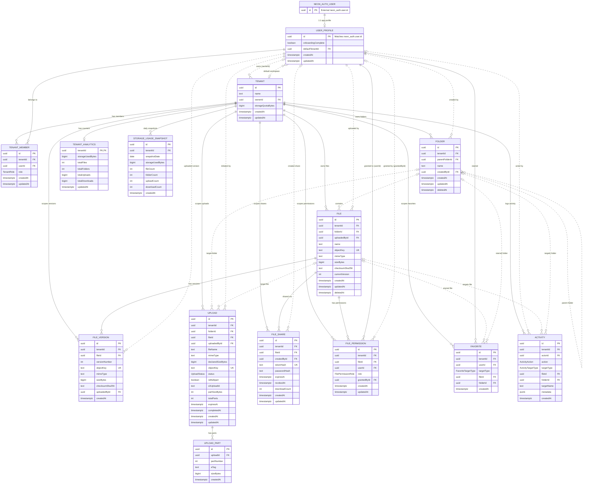

# Kinko Entity Relationship Diagram (Crow's Foot)

This document defines the relational data model for **Kinko**, derived from [schema.prisma](../apps/api/prisma/schema.prisma) and the repository's GitHub issues (`#1`–`#83`).

## 1. Issue-to-Model Traceability

| Model | Table (`@@map`) | GitHub Issues | Purpose |
| :--- | :--- | :--- | :--- |
| `UserProfile` | `user_profiles` | `#10`, `#19`, `#20` | App-owned user profile keyed 1:1 by `neon_auth.user.id` |
| `Tenant` | `tenants` | `#10`, `#18`, `#19`, `#32`, `#56` | Logical multi-tenant workspace & storage quota |
| `TenantMember` | `tenant_members` | `#10`, `#20`, `#21` | User-to-tenant membership and workspace role (`OWNER`, `ADMIN`, `MEMBER`) |
| `Folder` | `folders` | `#10`, `#23`, `#25`, `#31`, `#48`–`#51` | Hierarchical folders (`parentFolderId`) with soft deletion (`deletedAt`) |
| `File` | `files` | `#10`, `#24`, `#26`, `#28`–`#31`, `#48`–`#54`, `#60`, `#61`, `#68`, `#69` | File metadata, S3 object key, SHA-256 checksum, version pointer, soft deletion |
| `FileVersion` | `file_versions` | `#69` | Immutable historical versions of a file |
| `Upload` | `uploads` | `#28`, `#29`, `#70`, `#75` | Presigned single-PUT and S3 multipart upload intent tracking |
| `UploadPart` | `upload_parts` | `#70` | Completed parts (`partNumber`, `eTag`) for resumable multipart uploads |
| `FileShare` | `file_shares` | `#65` | Revocable, optionally password-protected and expiring share links |
| `FilePermission` | `file_permissions` | `#66` | Per-file `VIEWER` / `EDITOR` / `OWNER` access grants |
| `Favorite` | `favorites` | `#63` | User-starred files or folders (XOR target) |
| `Activity` | `activities` | `#10`, `#55`, `#62`, `#64` | Tenant-scoped audit & activity feed |
| `TenantAnalytics` | `tenant_analytics` | `#55`–`#58` | 1:1 materialized counters for fast dashboard overview queries |
| `StorageUsageSnapshot` | `storage_usage_snapshots` | `#59` | Daily time-series storage usage snapshots for charts |

> **Note on Authentication (`#10`, `#14`, `#15`, `#20`)**: Identity and session tables (`user`, `session`, `account`, `verification`) are managed by Neon Auth in the `neon_auth` schema and are intentionally **not** duplicated in Prisma. `NEON_AUTH_USER` is shown in the ERD below as an external reference entity.

---

## 2. Crow's Foot ERD



---

## 3. Crow's Foot Cardinality Constraints

| # | Parent Entity | Child Entity | Foreign Key | Crow's Foot | Cardinality (Parent : Child) | `ON DELETE` | Notes / Constraints |
| :-: | :--- | :--- | :--- | :---: | :---: | :--- | :--- |
| 1 | `NEON_AUTH_USER` | `USER_PROFILE` | `user_profiles.id` | `\|\|--o\|` | `1..1` : `0..1` | App-managed | Cross-schema logical 1:1 (`neon_auth.user.id`) |
| 2 | `USER_PROFILE` | `TENANT` | `tenants.ownerId` | `\|o..o{` | `0..1` : `0..N` | `SetNull` | Optional workspace owner |
| 3 | `TENANT` | `USER_PROFILE` | `user_profiles.defaultTenantId` | `\|o..o{` | `0..1` : `0..N` | `SetNull` | User's default workspace on onboarding |
| 4 | `TENANT` | `TENANT_MEMBER` | `tenant_members.tenantId` | `\|\|--o{` | `1..1` : `0..N` | `Cascade` | Composite `UNIQUE(tenantId, userId)` |
| 5 | `USER_PROFILE` | `TENANT_MEMBER` | `tenant_members.userId` | `\|\|--o{` | `1..1` : `0..N` | `Cascade` | Composite `UNIQUE(tenantId, userId)` |
| 6 | `TENANT` | `FOLDER` | `folders.tenantId` | `\|\|--o{` | `1..1` : `0..N` | `Cascade` | Tenant isolation |
| 7 | `FOLDER` | `FOLDER` | `folders.parentFolderId` | `\|o..o{` | `0..1` : `0..N` | `Cascade` | Self-referential tree (`NULL` = root) |
| 8 | `USER_PROFILE` | `FOLDER` | `folders.createdById` | `\|\|..o{` | `1..1` : `0..N` | `Restrict` | Creator audit |
| 9 | `TENANT` | `FILE` | `files.tenantId` | `\|\|--o{` | `1..1` : `0..N` | `Cascade` | Tenant isolation |
| 10 | `FOLDER` | `FILE` | `files.folderId` | `\|o..o{` | `0..1` : `0..N` | `Cascade` | `NULL` = root directory |
| 11 | `USER_PROFILE` | `FILE` | `files.uploadedById` | `\|\|..o{` | `1..1` : `0..N` | `Restrict` | Uploader audit |
| 12 | `TENANT` | `FILE_VERSION` | `file_versions.tenantId` | `\|\|--o{` | `1..1` : `0..N` | `Cascade` | Tenant isolation |
| 13 | `FILE` | `FILE_VERSION` | `file_versions.fileId` | `\|\|--o{` | `1..1` : `0..N` | `Cascade` | `UNIQUE(fileId, versionNumber)` |
| 14 | `USER_PROFILE` | `FILE_VERSION` | `file_versions.uploadedById` | `\|\|..o{` | `1..1` : `0..N` | `Restrict` | Version uploader |
| 15 | `TENANT` | `UPLOAD` | `uploads.tenantId` | `\|\|--o{` | `1..1` : `0..N` | `Cascade` | Tenant isolation |
| 16 | `FOLDER` | `UPLOAD` | `uploads.folderId` | `\|o..o{` | `0..1` : `0..N` | `SetNull` | Optional destination folder |
| 17 | `FILE` | `UPLOAD` | `uploads.fileId` | `\|o..o{` | `0..1` : `0..N` | `SetNull` | Linked file once finalized or new version |
| 18 | `USER_PROFILE` | `UPLOAD` | `uploads.uploadedById` | `\|\|..o{` | `1..1` : `0..N` | `Restrict` | Upload initiator |
| 19 | `UPLOAD` | `UPLOAD_PART` | `upload_parts.uploadId` | `\|\|--o{` | `1..1` : `0..N` | `Cascade` | `UNIQUE(uploadId, partNumber)` |
| 20 | `TENANT` | `FILE_SHARE` | `file_shares.tenantId` | `\|\|--o{` | `1..1` : `0..N` | `Cascade` | Tenant isolation |
| 21 | `FILE` | `FILE_SHARE` | `file_shares.fileId` | `\|\|--o{` | `1..1` : `0..N` | `Cascade` | Shared file |
| 22 | `USER_PROFILE` | `FILE_SHARE` | `file_shares.createdById` | `\|o..o{` | `0..1` : `0..N` | `SetNull` | Share link creator |
| 23 | `TENANT` | `FILE_PERMISSION` | `file_permissions.tenantId` | `\|\|--o{` | `1..1` : `0..N` | `Cascade` | Tenant isolation |
| 24 | `FILE` | `FILE_PERMISSION` | `file_permissions.fileId` | `\|\|--o{` | `1..1` : `0..N` | `Cascade` | `UNIQUE(fileId, userId)` |
| 25 | `USER_PROFILE` | `FILE_PERMISSION` | `file_permissions.userId` | `\|\|--o{` | `1..1` : `0..N` | `Cascade` | Permission recipient |
| 26 | `USER_PROFILE` | `FILE_PERMISSION` | `file_permissions.grantedById` | `\|o..o{` | `0..1` : `0..N` | `SetNull` | Permission granter |
| 27 | `TENANT` | `FAVORITE` | `favorites.tenantId` | `\|\|--o{` | `1..1` : `0..N` | `Cascade` | Tenant isolation |
| 28 | `USER_PROFILE` | `FAVORITE` | `favorites.userId` | `\|\|--o{` | `1..1` : `0..N` | `Cascade` | User who starred item |
| 29 | `FILE` | `FAVORITE` | `favorites.fileId` | `\|o..o{` | `0..1` : `0..N` | `Cascade` | `UNIQUE(tenantId, userId, fileId)`; XOR with `folderId` |
| 30 | `FOLDER` | `FAVORITE` | `favorites.folderId` | `\|o..o{` | `0..1` : `0..N` | `Cascade` | `UNIQUE(tenantId, userId, folderId)`; XOR with `fileId` |
| 31 | `TENANT` | `ACTIVITY` | `activities.tenantId` | `\|\|--o{` | `1..1` : `0..N` | `Cascade` | Tenant isolation |
| 32 | `USER_PROFILE` | `ACTIVITY` | `activities.actorId` | `\|o..o{` | `0..1` : `0..N` | `SetNull` | Preserves audit log if actor deleted |
| 33 | `FILE` | `ACTIVITY` | `activities.fileId` | `\|o..o{` | `0..1` : `0..N` | `SetNull` | Preserves audit log after permanent delete |
| 34 | `FOLDER` | `ACTIVITY` | `activities.folderId` | `\|o..o{` | `0..1` : `0..N` | `SetNull` | Preserves audit log after permanent delete |
| 35 | `TENANT` | `TENANT_ANALYTICS` | `tenant_analytics.tenantId` | `\|\|--o\|` | `1..1` : `0..1` | `Cascade` | Identifying 1:1 PK/FK counters |
| 36 | `TENANT` | `STORAGE_USAGE_SNAPSHOT` | `storage_usage_snapshots.tenantId` | `\|\|--o{` | `1..1` : `0..N` | `Cascade` | `UNIQUE(tenantId, snapshotDate)` |

---

## 4. Domain Integrity & Migration Notes

1. **Polymorphic XOR on `favorites`**:
   Prisma does not natively emit `CHECK` constraints. After generating your migration SQL, append:
   ```sql
   ALTER TABLE "favorites" ADD CONSTRAINT "favorites_target_xor_check" CHECK (
     ("targetType" = 'FILE' AND "fileId" IS NOT NULL AND "folderId" IS NULL) OR
     ("targetType" = 'FOLDER' AND "folderId" IS NOT NULL AND "fileId" IS NULL)
   );
   ```
2. **External `neon_auth.user` Mapping**:
   `user_profiles.id` is a non-autogenerated `UUID` populated from `neon_auth.user.id` on first authenticated request (`#19`). No cross-schema PostgreSQL foreign key is declared in Prisma so migrations stay isolated to the `public` schema.
3. **Key Indexes & Uniqueness**:
   - **Tenant-scoped lookups & trash**: `(tenantId, parentFolderId)`, `(tenantId, folderId)`, `(tenantId, deletedAt)` on `folders` and `files`.
   - **Duplicate detection (`#68`)**: `(tenantId, checksumSha256)` on `files`.
   - **Object storage keys**: `@unique` on `files.objectKey`, `file_versions.objectKey`, and `uploads.objectKey`.
   - **Analytics & Activity feeds**: `(tenantId, createdAt DESC)` on `activities`; `(tenantId, snapshotDate DESC)` and `UNIQUE(tenantId, snapshotDate)` on `storage_usage_snapshots`.
